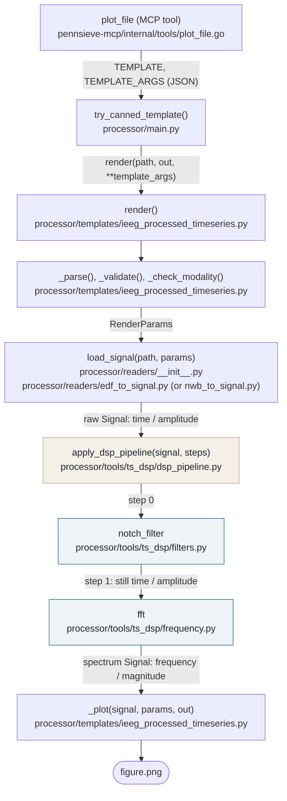
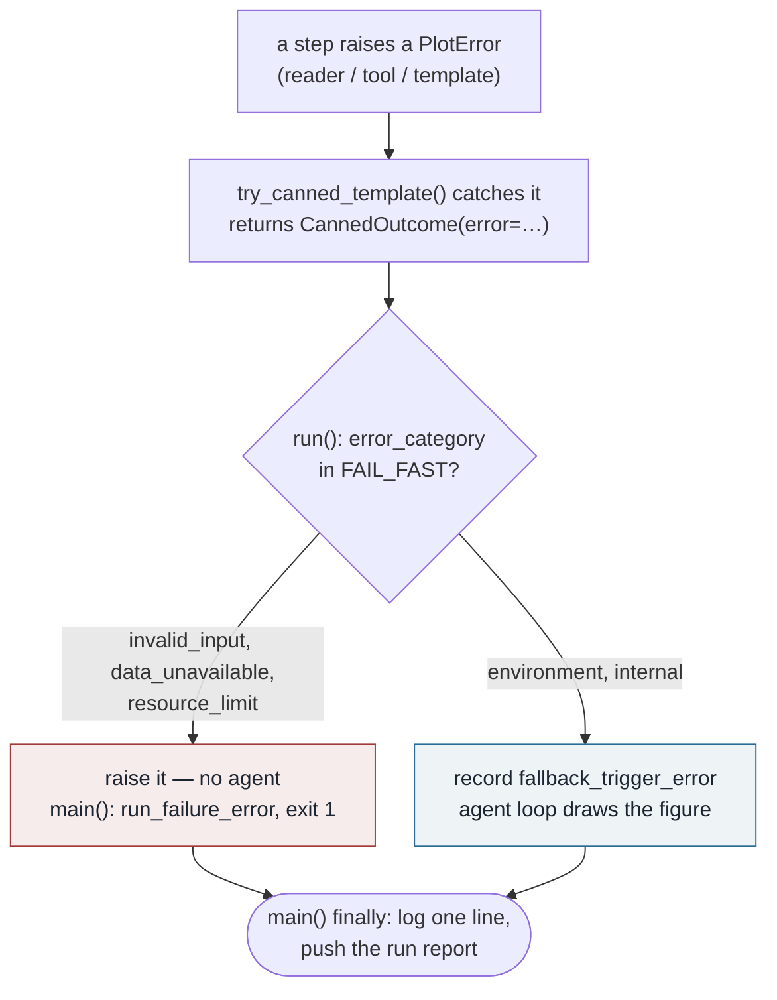

# How a request flows through the processor

This page follows one request through the code, function by function. The
top-level [README](../README.md) covers what the repo is and how to run it;
this one is for reading the code.

**Example request used throughout:** *"For `XXXX.edf`, view channel LA01 as
the montage LA01-LA02, from 500 s after onset for 50 s; notch out mains hum,
then show the FFT."* (An intracranial recording. Had the file been the
converter's `LA01_LA02.nwb`, only step 2 would differ: the registry would pick
the NWB reader.)

## The shape



White boxes are the fixed path every request takes. The tan box is the
pipeline runner. Blue boxes are the DSP tools, chosen by name at run time from
the request's `pipeline` list; they are the only part that differs between
requests.

Three folders, three jobs:

| folder | job | in → out |
|---|---|---|
| `templates/` | what to draw | user's `template_args` → `figure.png` |
| `readers/` | file → Signal | path + `RenderParams` → raw `Signal` |
| `tools/ts_dsp/` | Signal → Signal | `Signal` + step list → processed `Signal` |

`Signal` itself (`tools/ts_dsp/signal_definition.py`) is the contract all
three share: `t`, `y`, `fs`, `channel`, and four axis-metadata fields
(`x_domain`, `x_unit`, `y_domain`, `y_unit`) that say what the numbers
currently mean.

## Step by step

### `plot_file` — `pennsieve-mcp/internal/tools/plot_file.go`

The AI model reads the tool description (generated from
`schema/templates.json` and `schema/ts_tools.json`) and translates the user's
sentence into a template name plus arguments:

```json
{ "template": "ieeg_processed_timeseries",
  "template_args": { "channel": "LA01", "channel2": "LA02",
                     "start_time": 500, "duration": 50, "time_unit": "s",
                     "pipeline": [ {"tool": "notch_filter", "params": {"w0": 60}},
                                   {"tool": "fft", "params": {}} ] } }
```

`template_args` is JSON-encoded and forwarded unchanged (workflow →
`handler.py` → environment variable `TEMPLATE_ARGS`). Nothing along the way
inspects or normalises the pipeline list; the first code that does is the
pipeline runner.

**Output:** two environment variables, `TEMPLATE` and `TEMPLATE_ARGS`.

### `try_canned_template()` — `processor/main.py`

Unpacks `TEMPLATE_ARGS` back into a dictionary, looks the template up by name
in the template registry (`templates/__init__.py`), and calls its `render()`
with the file path, the output path and the argument dictionary.

**Output:** `render(target_file_path, output_path, **template_args)`.

### `render()` — `processor/templates/ieeg_processed_timeseries.py`

Six lines, one per step below. The only thing it checks itself is the file
extension (`.edf` or `.nwb`), which needs no file access.

```python
params = _parse(...)                                   # step 1
_validate(params)                                      # step 1
_check_modality(target_file_path, params)              # step 1, last part
signal = load_signal(target_file_path, params)         # step 2
signal = apply_dsp_pipeline(signal, params.pipeline)   # step 3
_plot(signal, params, output_path)                     # step 4
```

### Step 1 — `_parse()`, `_validate()`, `_check_modality()` — same file

`_parse` turns the raw dictionary into typed values: `start_time=500` is a
number, so with `time_unit="s"` it is 500 seconds from the recording start
(a `"13:20:36"` would have been a clock time, a `"2020-09-24 13:20:36"` a
full date; `tools/ts_dsp/units.py` reads all three and both readers anchor
them the same way); no `y_range` or `y_unit` was given; a second channel was
given, so this is a montage; no `modality` was given.

`_validate` applies the rules that need only the user's inputs: channel and
start time present, at least one of end time / duration, the two montage
channels differ. Neither function opens the file.

`_check_modality` asks the reader for the file's channel names and
`tools/ts_dsp/modality.py` what they look like: LA01, LA02, … are numbered
contacts of electrode arrays, so "ieeg", which this template declares in
`SUPPORTED_MODALITIES`. A file whose names were Fp1, Cz, O2 … would be
refused here (`unsupported_modality`) unless the request said
`modality="ieeg"`; names nobody can place are let through.

**Output:** a `RenderParams` — `channel="LA01"`, `channel2="LA02"`,
`montage=True`, `start=500 s`, `duration_s=50`, `y_limits=None`,
`volt=None`, `pipeline=[…]`, `modality=None`.

### Step 2 — `load_signal(path, params)` — `processor/readers/`

`readers/__init__.py` sees `.edf` and hands off to `edf_to_signal.py` (`.nwb`
would go to `nwb_to_signal.py`; both work the same way), in four functions:

1. `_read_header` — open the EDF with pyedflib and read only the header:
   channel names, sampling rate, recording length and unit per channel, and
   the recording's start date and time.
2. `_check_against_header` — everything about the request that could only be
   checked with the header in hand: LA01 and LA02 exist and share a sampling
   rate; the window (via `readers/window.py`, the rules every reader shares:
   a clock or date start would be anchored to the header's start here, end
   and duration must agree, 500–550 s lies inside the recording and under
   the 600 s cap, enough samples); no `y_unit` was given, so use the unit the
   file declares for LA01 (here µV; an NWB file stores volts and is shown in
   µV). The NWB reader adds one check of its own: a recording with gaps
   carries per-sample timestamps, and a window that crosses a gap is refused
   (`window_spans_gap`, naming the hole) rather than drawn stitched.
3. `_read_channels` — read LA01 and LA02 between 500 s and 550 s; subtract to
   get the montage.
4. `_build_signal` — convert to µV and package as a `Signal`.

Rule of thumb for where a check lives: if it can be done without the file it
is in `_parse`/`_validate`; if it needs the header it is in the reader; if it
is about the window and not the format, it is in `readers/window.py`.

**Output:** a raw `Signal` — `t` in seconds from recording start (500 … 550),
`y` in µV (LA01 minus LA02), `fs`, `channel="LA01-LA02"`, `x_domain="time"`,
`y_domain="amplitude"`, `recording_start` from the header (a datetime: naive
for EDF, the recorder's own clock; UTC for the converter's NWB).

### Step 3 — `apply_dsp_pipeline(signal, steps)` — `tools/ts_dsp/dsp_pipeline.py`

The template forwards the pipeline list without knowing which tools exist.
The runner goes through the steps in order; for each one it

1. looks the tool name up in `_REGISTRY`, the dictionary built from the
   explicit `ALL_TOOLS` list in `tools/ts_dsp/__init__.py`;
2. checks the parameters — all required ones present, no unknown ones;
3. checks the `Signal` is the right kind of data for this tool (each tool
   declares `requires`, e.g. a filter needs `x_domain="time"`, `y_domain="amplitude"`);
4. runs the tool, which returns a new `Signal`.

**Step 0 — `notch_filter(signal, w0=60)`** (`filters.py`). Gate passes: the
signal is a time trace of voltage. Builds a narrow scipy filter centred on
60 Hz and runs it forwards and backwards so the trace is not shifted in time.
Returns the same `t`, filtered `y`; domains unchanged (`produces={}`).

**Step 1 — `fft(signal)`** (`frequency.py`). Gate passes: still time /
amplitude after the notch. Computes how much of each frequency is present in
the 50 s trace. Returns a `Signal` whose x-axis is now frequency in Hz and
whose y-axis is magnitude in µV (`x_domain="frequency"`,
`y_domain="magnitude"`).

Had the user asked for fft *then* notch, step 1 would fail the gate with
`notch_filter expects x_domain='time', but the signal is x_domain='frequency'`.

**Output:** the spectrum `Signal`, back to `render()`.

### Step 4 — `_plot(signal, params, output_path)` — same file as `render()`

The y-axis is no longer voltage, so a voltage `y_range` would be ignored and
the axis is scaled to the data. The x-axis is formatted from `params`: numeric
input → plain numbers in the user's unit; clock or date input → H:M:S ticks
anchored at `signal.recording_start`, the label naming the clock
(`"time (h:m:s, local)"` for EDF, `"time (h:m:s, UTC)"` for the converter's
NWB) and, only when the window crosses midnight, the date it starts on. A
spectrum is drawn as-is. Axis labels come straight off the `Signal`
(`"frequency (Hz)"`, `"magnitude (µV)"`).

**Output:** `OUTPUT_DIR/figure.png`.

### Back in `main.py`

`figure.png` exists, so `try_canned_template()` returns
`CannedOutcome(produced=True)`, `run()` notes on the run report that the
template drew the figure and how big it is, and `main()` marks the run
`succeeded` and pushes the report. Had any step raised, the request would
have taken one of the two routes below.

## How a failed request flows through

Every failure is a `PlotError` (`processor/errors.py`): one of five classes
named for who can fix it (`PlotInvalidInputError`, `PlotDataUnavailableError`,
`PlotResourceLimitError`, `PlotEnvironmentError`, `PlotInternalError`), raised
by the code that found the problem and still has the facts. It travels up
through `render()` untouched and is caught in `main.py`, where `run()` decides
between two routes by its category (`FAIL_FAST`):



### Route A — fail fast: the user asked for a channel the file doesn't have

Same request as above, but `"channel": "ZZ"`; the file has LA01, LA02, LA03.

1. **Step 2, `load_signal()`** (`readers/edf_to_signal.py`) — `_Header.index("ZZ")`
   finds no match and raises

   ```python
   PlotInvalidInputError(
       PlotErrorCode.UNKNOWN_CHANNEL,
       "Channel 'ZZ' is not in the file. Available channels: LA01, LA02, LA03",
       error_facts={"channel": "ZZ", "available_channels": ["LA01", "LA02", "LA03"]},
       source_stage=PlotErrorStage.READER)
   ```

   The reader is the only place that knows the channel list, so the reader
   is where the message is written.
2. **`render()`** — does not catch it; the error passes straight up.
3. **`try_canned_template()`** (`main.py`) — catches it. It is already a
   `PlotError`, so `wrap_unexpected_exception()` hands it back unchanged and
   `source_stage` stays `reader`. Any half-written `figure.png` is removed and
   `CannedOutcome(error=…)` is returned.
4. **`run()`** — `invalid_input` is in `FAIL_FAST`: the user can fix this and
   the agent cannot, so no fallback. `raise canned.error`.
5. **`main()`** — `except PlotError`: `report.run_failure_error = err`, exit
   code 1. The `finally` logs one line and pushes the report to the run's
   outputs in workflow-service:

   ```
   Quick-plot failed [invalid_input/unknown_channel at reader]: Channel 'ZZ' is not in the file. Available channels: LA01, LA02, LA03
   ```
   ```
   quickplot.run_status                       = failed
   quickplot.run_failure_error.error_category = invalid_input
   quickplot.run_failure_error.error_code     = unknown_channel
   quickplot.run_failure_error.source_stage   = reader
   quickplot.run_failure_error.user_message   = Channel 'ZZ' is not in the file. Available channels: LA01, LA02, LA03
   quickplot.run_failure_error.user_next_step = Check the plot settings (channel, time window, units) and try again.
   quickplot.run_failure_error.error_facts    = {"available_channels": ["LA01", "LA02", "LA03"], "channel": "ZZ"}
   ```

Total: a few seconds, and the template's own sentence reaches the run record.

### Route B — fall back: the compute node is missing a library

Same request, correct channel, but the EFS layer lacks `pyedflib`.

1. **Step 2, `load_signal()`** — `import pyedflib` inside the reader raises a
   plain `ImportError`. Nobody in our code raised it, so it is not yet a
   `PlotError`.
2. **`render()`** — passes it up.
3. **`try_canned_template()`** — catches it. `wrap_unexpected_exception()`
   turns the `ImportError` into
   `PlotEnvironmentError(MISSING_DEPENDENCY, "The compute node is missing a
   dependency the plot needs (pyedflib).")`. It had no stage, so the catch
   site stamps `source_stage = template`. Returns `CannedOutcome(error=…)`.
4. **`run()`** — `environment` is *not* in `FAIL_FAST`: the user cannot fix a
   missing library, but the agent, which runs its scripts in a subprocess,
   may still manage. The error is kept as `report.fallback_trigger_error` and
   the agent loop runs with the user's `PROMPT`.
5. **Agent succeeds** — `run()` notes `figure_generated_by = "agent"` and
   returns normally; `main()` marks the run `succeeded`. The report still
   carries the reason the canned plot did not happen:

   ```
   quickplot.run_status                            = succeeded
   quickplot.figure_generated_by                   = agent
   quickplot.fallback_trigger_error.error_category = environment
   quickplot.fallback_trigger_error.error_code     = missing_dependency
   quickplot.fallback_trigger_error.source_stage   = template
   quickplot.fallback_trigger_error.user_message   = The compute node is missing a dependency the plot needs (pyedflib).
   ```

   Had the agent failed too, `run()` would raise
   `PlotInternalError(AGENT_FAILED, …)` and the run would end as in Route A,
   step 5, with both `run_failure_error.*` and `fallback_trigger_error.*` on
   the record.

Without `EXECUTION_RUN_ID` (a local run, a unit test) nothing is pushed; the
log line is the report.

## Run it locally

You have an EDF (or NWB) file and want the PNG without the platform in the loop.
The processor reads its request from environment variables, so one command
does it:

```sh
pip install -r requirements-dev.txt          # numpy, scipy, pyedflib, h5py, matplotlib, pytest
mkdir -p /tmp/qp/in /tmp/qp/out
cp /path/to/your/recording.edf /tmp/qp/in/

INPUT_DIR=/tmp/qp/in \
OUTPUT_DIR=/tmp/qp/out \
TARGET_FILE_NAME=recording.edf \
TEMPLATE=ieeg_processed_timeseries \
TEMPLATE_ARGS='{"channel": "LA01", "channel2": "LA02",
                "start_time": 500, "duration": 50, "time_unit": "s",
                "pipeline": [{"tool": "notch_filter", "params": {"w0": 60}},
                             {"tool": "fft", "params": {}}]}' \
python -m processor.main

open /tmp/qp/out/figure.png                  # macOS; xdg-open on Linux
```

`TEMPLATE_ARGS` is exactly the JSON the MCP tool would have built from the
user's sentence (the example above is the request traced on this page); the
keys are the ones listed under `ARGS_SPEC` in the template. Drop `pipeline`
for a raw trace; use `"end_time"` instead of `"duration"`, or clock strings
such as `"start_time": "13:12:36"` (or `"2020-09-24 13:12:36"` for a
recording that runs for days) with no `time_unit`, as the template allows. A warning that the layer site-packages were not found is expected
outside AWS and harmless: locally the dependencies come from your own
environment. If the template raises, the processor logs the reason and then
tries the LLM agent path, which needs `PROMPT` and `LLM_GOVERNOR_URL`; for a
template-only run you can ignore that second error.

To call the template from Python instead (e.g. in a notebook):

```python
from processor.templates import ieeg_processed_timeseries as t
t.render("/tmp/qp/in/recording.edf", "/tmp/qp/out/figure.png",
         channel="LA01", channel2="LA02", start_time=500, duration=50, time_unit="s",
         pipeline=[{"tool": "notch_filter", "params": {"w0": 60}}, {"tool": "fft"}])
```

`make run` (docker-compose, reads `dev.env`) exercises the same path inside
the container image; see the top-level README.

## Adding things

* **A tool:** write a `Signal -> Signal` function in the matching
  `tools/ts_dsp/` module, decorate it with `@dsp_tool(...)`, add it to
  `ALL_TOOLS` in `tools/ts_dsp/__init__.py`, run `make schemas`.
* **A file format:** add `readers/<format>_to_signal.py` exposing
  `load_signal(path, params) -> Signal`, register its extension in
  `readers/__init__.py`, add the extension to the template's
  `SUPPORTED_EXTENSIONS`. The template and the tools do not change.
* **A template:** see "Adding a canned template" in the top-level README.
